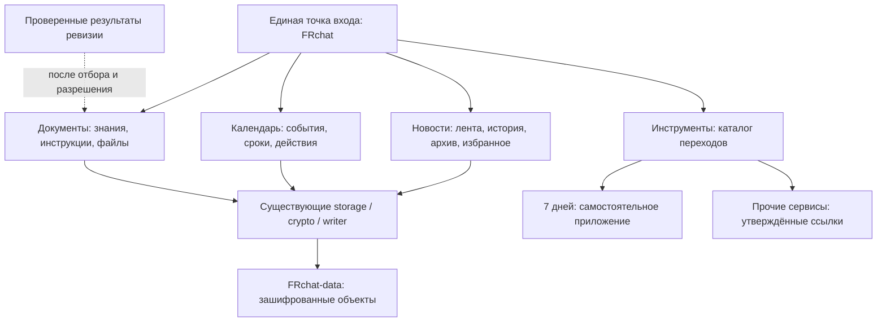

# Архитектура единого пространства франшизы

13 ноября 2026. Целевая архитектура. Первая версия оболочки и управления содержимым реализована локально; опубликованный пилот не перестраивался. Связанные документы: [пакет просмотра](WORKSPACE_PREVIEW.md), [аудит](IMPLEMENTATION_AUDIT_2026-11-13.md), [дорожная карта](DEVELOPMENT_PLAN.md).

## 1. Оболочка на основе FRchat

Использовать существующий React/Vite FRchat как точку входа. Сохранить самостоятельные приложения, их репозитории и хранилища. Первому выпуску не нужны новый сервер, SSO и перенос данных.



Единая навигация — законченный первый этап. Она не делает данные и авторизацию внешних сервисов общими. Не объединять приложения только ради общей шапки.

## 2. Повторное использование и границы модулей

Целевая структура, пока не созданная:

```text
src/app/                    оболочка, маршруты, совместимость ссылок
src/features/news/          Feed, PostCard, PostView, Archive, Favorites
src/features/calendar/      CalendarView, agenda, ближайшие сроки
src/features/documents/     Reference/Files adapters, DocumentsView
src/features/tools/         ToolsView, проверенный реестр переходов
src/admin/                  существующий редактор и настройка публикации
src/lib/                    crypto, storage, writer, dates, search
```

Первый PR выделяет компоненты из src/main.tsx без смены поведения и ключей storage. Существующий hash-router достаточен; microfrontend runtime, новый монорепозиторий и переписывание доменных правил не нужны.

| Переиспользуем                     | Сохраняем                                                 | Новая работа                                       |
| ---------------------------------- | --------------------------------------------------------- | -------------------------------------------------- |
| Feed/PostView/ManagerEditor        | Публикации, история, черновики, напоминания, предпросмотр | Общая оболочка; точность заголовков/дат            |
| CalendarView + dates.mjs           | МСК, серии, сроки и архив                                 | Ближайшие действия, связи с документами            |
| Reference + FilesView + Attachment | Статьи, вложения, безопасное скачивание                   | Единый экран документов и наполнение; позже версии |
| search.mjs / filters.mjs           | Поиск в расшифрованном снимке, нормализация, группы       | Общий тип результата, разрешённые внешние адаптеры |
| storage / crypto / writer          | SHA-пути, AES-GCM, целостность, атомарный commit          | Совместимые расширения по отдельному решению       |
| DailyTask                          | JSON дней, стабильные id, переход на день                 | Карточка «7 дней» в каталоге                       |
| Самостоятельные инструменты        | Их работающий код и данные                                | Назначение и проверенная ссылка в реестре          |

## 3. Навигация и совместимость

Телефон: четыре подписанных пункта — Новости, Календарь, Документы, Инструменты. Компьютер: те же разделы в боковой навигации. Избранное/архив видны внутри «Новостей», справочник/файлы — внутри «Документов». Скрытое «Ещё» не возвращать.

| Старый адрес                            | Поведение после П1                      |
| --------------------------------------- | --------------------------------------- |
| #/feed, #/                              | Новости                                 |
| #/post/<id>                             | Та же карточка и ссылка из MAX          |
| #/favorites                             | Избранное «Новостей», отметки сохранены |
| #/archive                               | Архив «Новостей»                        |
| #/calendar                              | Календарь с прежними фильтрами          |
| #/reference                             | Документы: справочные материалы         |
| #/files                                 | Документы: якорь к файлам               |
| #/documents                             | Новый канонический адрес документов     |
| #/tools                                 | Новый каталог инструментов              |
| #/admin/new, #/admin/edit/<id>, #/setup | Прежние административные сценарии       |

На первом этапе не переименовывать ключи localStorage/IndexedDB. Если позже появятся персональные межустройственные отметки, предусмотреть совместимое чтение прежнего состояния; не очищать его при первом входе.

## 4. Документы: сначала адаптеры

В первой локальной реализации сохранены Post.type=reference и существующая запись по месяцам. Добавлены опциональный Post.document с метаданными и специальная reference-запись frchat-workspace-settings с версией настроек, категориями и инструментами. Она исключена из пользовательских списков, поиска и прямого просмотра, но не является отдельным секретом или новой границей доступа. Все эти поля шифруются и сохраняются GitDataWriter.savePost вместе с остальными записями; изменение одной настройки разрешается на уровне записи целиком. Старые снимки читаются без миграции и получают значения по умолчанию в памяти. Прежние файлы остаются внутри attachments (superseded_at, version_label), поэтому существующая ротация также перешифровывает их. Совместимость проверена отдельными тестами чтения/записи, импорта и ротации. Подробности реализации — в пакете просмотра.

FileEntry сейчас привязан к посту; Post/reference уже хранит справочную статью. Их можно представить общим экраном без миграции:

```ts
type DocumentViewItem = {
  id: string; // reference:<postId> либо attachment:<postId>:<fileId>
  sourceKind: "reference" | "attachment";
  sourcePostId: string;
  fileId?: string;
  title: string;
  category: string;
  updatedAt: string;
  href: string;
};
```

Это вычисляемое представление в памяти, не публичный plaintext index. Файл открывается существующим защищённым download после входа. Название документа и его метаданные тоже могут быть внутренними.

Старые пять категорий справочника сохраняются как справочная информация. Темы регламентов, договоров, бланков и бренда добавляются аддитивно до наполнения; классификация подтверждается владельцем, а не угадывается по расширению файла. Размещение в новом разделе не меняет категории существующих постов автоматически.

Когда понадобятся собственные версии, добавить отдельную опциональную коллекцию: document_id, категория, теги, ответственный, дата актуальности, аудитория, действующая версия и previous_versions. Не вводить `type=document` в Post, где сейчас разрешены только post/reference. Старые записи сначала остаются источниками через адаптеры.

До изменения схемы проверить всех писателей. Сохранение дополнительных полей индекса через spread в текущем writer не доказывает совместимость каждой утилиты/ротации. Нужны round-trip тесты, версия возможностей и остановка старого writer, если он теряет новые поля.

FrDomianReview даёт каталог со стабильными id и отдельные решения ревизии. Голоса, служебные комментарии, токены проверяющих и карантин не являются базой знаний собственников. Адаптер принимает только подтверждённые актуальные материалы с владельцем и допустимой аудиторией. Одного поля manifest недостаточно для автоматического допуска.

Внутренние файлы и чувствительные метаданные остаются зашифрованными. Только отдельно одобренные публичные материалы допустимы по открытым ссылкам. Заполненные договоры, пустые бланки и логотипы могут иметь разные правила.

## 5. Каталог инструментов и «7 дней»

Реестр: id, название, назначение, проверенный URL/route, порядок, состояние доступности, владелец. В публичную конфигурацию входят только одобренные публичные сведения; чувствительные названия/ссылки относятся к зашифрованным данным.

Публичный JSON «7 дней» подтверждён: schema_version/content_version и семь дней. FRchat сохраняет текущий переход на день и осторожное чтение локального прогресса; запись чужого storage не добавляется. Ссылка возврата внутри другого приложения — отдельный PR этого приложения после разрешения. Пока доступна навигация браузера.

Другие калькуляторы/мотивация включаются только по утверждённому реестру. Наличие папки или картинки калькулятора не подтверждает опубликованный сервис. EventFlow — кандидат лишь после проверки аудитории и адреса; его данные не объединяются с FRchat автоматически.

Переход не содержит пароль, общий код, токен или содержимое документа в URL/query/hash. Для внешнего сервиса сохраняется его собственный вход. Iframe не используется как ускоренный способ объединения.

Показ карточки инструмента по роли — удобство навигации, а не защита публичного внешнего приложения. Реальные права определяет сам сервис. На первом этапе публичный реестр содержит только заранее одобренные общедоступные ссылки; редактор произвольных ссылок и зашифрованный внутренний реестр — отдельное расширение.

## 6. Доступы и роли

Сейчас поддерживаются admin и reader: один администратор, 14 читателей. Owner/editor — не реализованные роли. Именной читатель добавляется через зашифрованную обёртку и manifest без редактирования кода, но пока служебной командой, не панелью владельца.

Добавление из будущей админки может переиспользовать доступный admin общий код и GitDataWriter. Смена/отзыв требуют больше: старый зашифрованный доступ остаётся в Git и раскрывает прежний общий ключ. Сейчас rotateAccess меняет epoch/ключ и перешифровывает рабочие данные; для сохранения остальных паролей нужны локальные пароли оставшихся записей.

До полного П3 нужен ADR:

| Вариант                                                           | Возможности                                                                              | Ограничения и необходимая новая работа                                                                                               |
| ----------------------------------------------------------------- | ---------------------------------------------------------------------------------------- | ------------------------------------------------------------------------------------------------------------------------------------ |
| A. Обёртки пользовательских ключей под отдельным ключом владельца | Управление без хранения чужих паролей в интерфейсе, повторное использование криптографии | Отдельный recovery/escrow, смена ключа владельца, согласованное создание обёрток и ротация; не даёт серверных прав редактора или SSO |
| B. Минимальный доверенный сервис доступа и разрешённых операций   | Управление участниками, разделение владельца/редактора, основа журнала и уведомлений     | Размещение, секреты сервиса, сессии, recovery, модель ключей; совместимость паролей проверяется на копии; переход только по решению  |

Для роста единого пространства рекомендовано проектировать B как общую основу, но П1/П2 его не требуют. При выборе полностью статической эксплуатации A оценивается отдельно, без обещания настоящего SSO.

Скрытая кнопка не ограничивает редактора, которому выдан Contents: write на весь data-репозиторий. Настоящая граница «публиковать, но не менять участников» требует доверенного контроля операций или разделения полномочий хранилища. Не выдавать фронтенд-роль за защиту.

В обоих вариантах сохранить текущие пароли, кроме адресных замен. Проверить чужой id/роль, потерю ответа, двойное нажатие и восстановление владельца. Не загружать локальный реестр паролей в браузер. Старые скачанные копии и историю Git отзыв не стирает.

## 7. Следующие интеграции

Текущий поиск охватывает расшифрованный снимок FRchat. Документы получают представление результатов, а не автоматическую индексацию внешних файлов.

Будущий адаптер выдаёт id, тип, заголовок, описание, стабильный href, источник и проверенную доступность. Недоступные сведения исключаются до выдачи результата; скрытая кнопка не защищает уже выданный текст. Отказ источника означает частичный результат, не остановку портала.

Текущее Post.related ссылается на другие посты. Id документа/инструмента не добавляется туда под видом поста. Для новых связей нужен отдельный опциональный ResourceRef (kind/id/source) с проверкой совместимости писателей. В П1 достаточно проверенных ссылок без нового формата.

Полный текст PDF/Office и OCR требуют отдельной оценки и разрешённого хранения индекса. Ближайшие действия сначала выводятся из DateEntry и ссылок на форму/инструкцию. Персональное выполнение — отдельная модель, не поле общего поста.

Фоновым уведомлениям нужны планировщик, доставка и идентификация получателей; таймер страницы этого не обеспечивает. Центральный журнал и тематические обсуждения строятся после решения по авторизации, не через подключение сторонних скриптов.

## 8. Общий origin и безопасность

У путей lesauteur.github.io один origin: доступ к Web Storage не разделяется каталогами. Префиксы frchat.* и domian:* нужны для совместимости, но не являются изоляцией. Новое окно также не разделяет storage. Основание: [MDN, same-origin policy](https://developer.mozilla.org/en-US/docs/Web/Security/Defenses/Same-origin_policy).

На П1 сохраняются запрет сторонней аналитики/виджетов, строгая CSP и отсутствие исполнения удалённых скриптов интеграции. Для будущей изоляции рассмотреть отдельный origin защищённого портала, но не переезжать автоматически. Отдельный origin сам по себе не создаёт SSO.

Для серверного варианта заранее решить работу сессий в MAX/мобильных браузерах, проверку origin/CSRF и recovery. Общий владелец сайтов не является готовым механизмом общей авторизации.

## 9. Откат

Если позднее будет выбран отдельный origin, прежние localStorage/IndexedDB не переедут автоматически. Чтение локального прогресса «7 дней» из FRchat на другом origin также перестанет быть доступным. Нужны отдельно согласованные перенос/экспорт или корректное отсутствие индикатора; не передавать пароль через URL ради сохранения прогресса.

П1 откатывается кодом, сохраняя данные и старые маршруты. П2 начинает с адаптеров; создание документов/расширение индекса — отдельная разрешённая запись. П3/SSO имеют собственные резервный снимок, репетицию и защиту от старого писателя. Ни одно изменение хранения, сервиса доступа или схемы в этом аудите не выполнялось.
